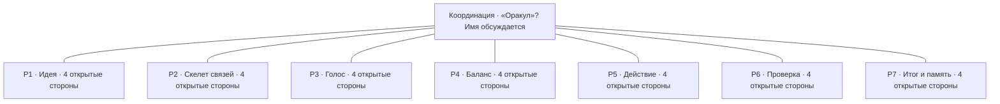

# Семь карточек

Статус: рабочий публичный скелет, 0.1.0-draft.

Линии схемы показывают обзор, а не утверждённые потоки данных или обязательный порядок исполнения. Стороны — адреса для дальнейшего исследования, не четыре готовые функции. Двойственные аспекты пока не добавлены как самостоятельные машинные адреса. Итого 28, не 56 заполненных ячеек.

## P1 · Идея

Рабочее название, не окончательная инженерная роль.

**Вопрос для обсуждения:** Какую задачу и для кого решает система?

| Адрес | Смысл |
|---|---|
| `P1.front` | Открыто · `unassigned` |
| `P1.right` | Открыто · `unassigned` |
| `P1.back` | Открыто · `unassigned` |
| `P1.left` | Открыто · `unassigned` |

## P2 · Скелет связей

Рабочее название, не окончательная инженерная роль.

**Вопрос для обсуждения:** Какие компоненты и зависимости нужны?

| Адрес | Смысл |
|---|---|
| `P2.front` | Открыто · `unassigned` |
| `P2.right` | Открыто · `unassigned` |
| `P2.back` | Открыто · `unassigned` |
| `P2.left` | Открыто · `unassigned` |

## P3 · Голос

Рабочее название, не окончательная инженерная роль.

**Вопрос для обсуждения:** Как система объясняет намерения и результаты?

| Адрес | Смысл |
|---|---|
| `P3.front` | Открыто · `unassigned` |
| `P3.right` | Открыто · `unassigned` |
| `P3.back` | Открыто · `unassigned` |
| `P3.left` | Открыто · `unassigned` |

## P4 · Баланс

Рабочее название, не окончательная инженерная роль.

**Вопрос для обсуждения:** Как соразмерять пользу, ресурсы и риски?

| Адрес | Смысл |
|---|---|
| `P4.front` | Открыто · `unassigned` |
| `P4.right` | Открыто · `unassigned` |
| `P4.back` | Открыто · `unassigned` |
| `P4.left` | Открыто · `unassigned` |

## P5 · Действие

Рабочее название, не окончательная инженерная роль.

**Вопрос для обсуждения:** Что можно исполнить и как отменить последствия?

| Адрес | Смысл |
|---|---|
| `P5.front` | Открыто · `unassigned` |
| `P5.right` | Открыто · `unassigned` |
| `P5.back` | Открыто · `unassigned` |
| `P5.left` | Открыто · `unassigned` |

## P6 · Проверка

Рабочее название, не окончательная инженерная роль.

**Вопрос для обсуждения:** Как отличить подтверждённый результат от предположения?

| Адрес | Смысл |
|---|---|
| `P6.front` | Открыто · `unassigned` |
| `P6.right` | Открыто · `unassigned` |
| `P6.back` | Открыто · `unassigned` |
| `P6.left` | Открыто · `unassigned` |

## P7 · Итог и память (предварительно)

Рабочее название, не окончательная инженерная роль.

**Вопрос для обсуждения:** Что сохранить, пересмотреть и передать следующему шагу?

| Адрес | Смысл |
|---|---|
| `P7.front` | Открыто · `unassigned` |
| `P7.right` | Открыто · `unassigned` |
| `P7.back` | Открыто · `unassigned` |
| `P7.left` | Открыто · `unassigned` |

## Как читать открытые места

front/right/back/left — технические адреса, не назначенные смыслы. Порядок этих слов не устанавливает соответствие числам сторон в разговоре. Прикладные вопросы выше — предложения для обсуждения, они не занимают стороны автоматически. P7 особенно предварителен.

[Назад к обзору](../README.md) · [Машинная версия](../model/skeleton.json)
